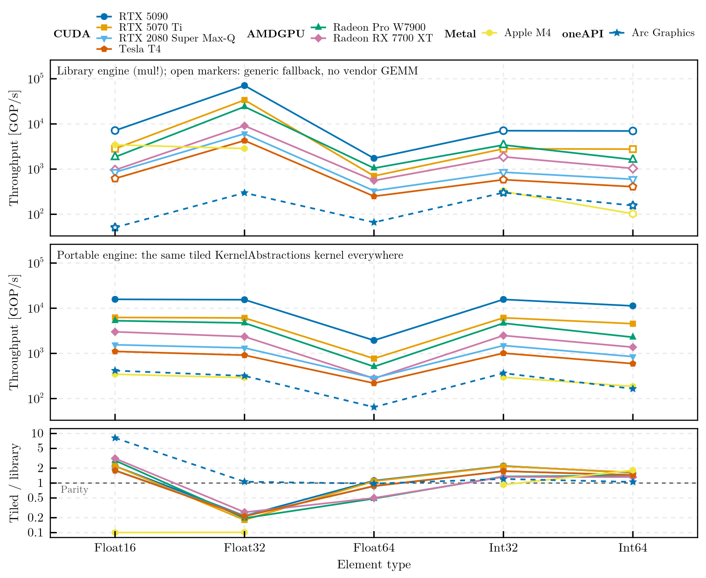
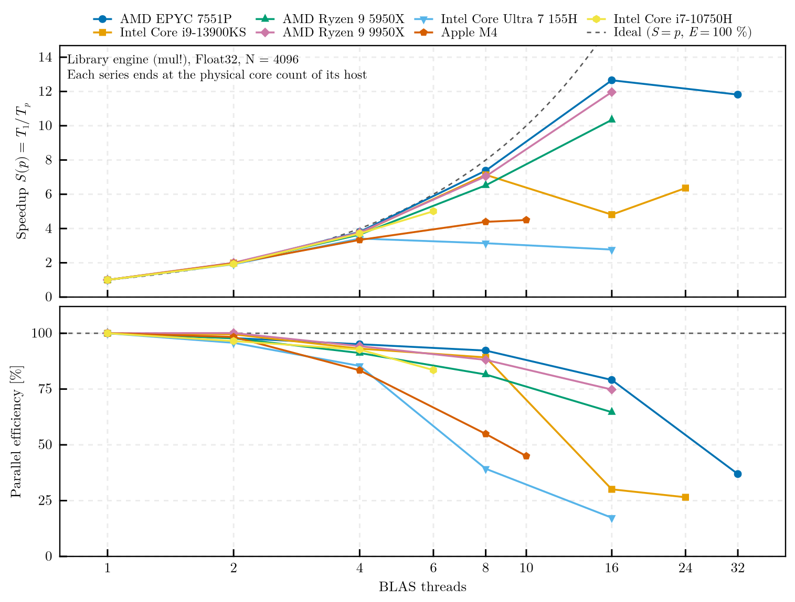

# scicomp-toolbox

[](https://github.com/PaulGoG/scicomp-toolbox/actions/workflows/ci.yml?query=branch%3Amain)
[](https://github.com/JuliaTesting/Aqua.jl)
[](https://github.com/aviatesk/JET.jl)
[](https://github.com/PaulGoG/scicomp-toolbox/actions/workflows/format.yml?query=branch%3Amain)
[](https://julialang.org/downloads/)
[](#requirements)

Scientific scripting workbench in Julia. It hosts standalone utilities and self-contained
tools that do not warrant a repository of their own, behind a common dispatcher, test
runner and formatting gate.

```
scicomp-toolbox/
├── run.jl                  # dispatcher: list and run tools
├── test.jl                 # global test runner
├── check.jl                # pre-commit: format, then test
├── formatter/              # pinned JuliaFormatter environment
├── standalone/             # tier 2: sysinfo, workspace-audit, commit-guard
├── hardware-diagnostics/   # tier 1: host and GPU benchmark, package HardwareDiagnostics
├── plot-benchmarks/        # tier 1: figures from its datasets
├── run-index/              # tier 1: catalogue of run directories
├── slurm-launch/           # tier 1: job scripts, submission, status
├── convergence/            # tier 1: observed order of accuracy, package Convergence
├── figure-audit/           # tier 1: exported figures against a column width
├── bib-hygiene/            # tier 1: BibTeX validation
├── reference-runs/         # datasets of the eight validation runs
└── assets/                 # figures of this README
```

The [full tree](#full-tree) is at the end.



Output of `hardware-diagnostics` drawn by `plot-benchmarks`, pooled over the eight runs in
[`reference-runs/`](reference-runs/): the same operation, D = A·B + A·C at N = 4096, on
eight accelerators of four vendors, through the library path of each device and through
one tiled KernelAbstractions kernel compiled for all of them from the same source. Where a
tuned vendor GEMM exists the library leads by 3.9 to 5.5× at `Float32` on the six
discrete cards; where `mul!` falls back to the generic GPUArrays path, the portable kernel
leads on every device but the M4. The README of
[`reference-runs/`](reference-runs/README.md#figures) reads the figure device by device.



The host side of the same eight runs: seven processors from six to 32 physical cores,
x86_64 and arm64. Each series ends at the physical core count of its host, and the shape
of its tail follows the topology. The EPYC regresses past 16 threads across its four dies,
while both hybrid Intel parts lose efficiency as soon as the sweep spreads past their
performance cores (efficiency 30 % at 16 threads for the i9-13900KS, 17 % at 16 for the
Core Ultra 7 155H). The M4 shows the same knee at its four performance cores and falls to
45 % at 10 threads, where the sweep includes its efficiency cores.

```bash
julia run.jl hardware-diagnostics --stress                   # one machine
julia run.jl plot-benchmarks --compare                       # both figures above
```

## Two tiers

A **tier 1 tool** is a directory with its own `Project.toml`, an `activate.jl`, a
validated `config.toml`, the entry point `<name>/<name>.jl`, a test suite under `test/`
and a README. A tool that outgrows a script becomes a package inside
that directory (`name` and `uuid` in `Project.toml`, `src/<Name>.jl`); the dispatcher and
the test runner handle both forms. Tools never share an environment, so their
dependencies cannot conflict. A new tool starts as a pruned copy of `plot-benchmarks/`.

A **tier 2 script** in `standalone/` relies on the standard library only and runs without
instantiation. The `Project.toml` beside the scripts exists for their shared test suite
in `standalone/test/`, which the global runner discovers like any other. Running a script
never needs it, and the dispatcher does not list `standalone/` as a tool.

## Requirements

Julia 1.12 or later through [juliaup](https://github.com/JuliaLang/juliaup). Every
environment declares `julia = "1.12"` and bounds each dependency in `[compat]`. Manifests
are not tracked: an environment is resolved on its first run by the Julia release that
runs it. Linux is the primary platform and the one CI covers;
`hardware-diagnostics` has also run on macOS/arm64 with the Metal backend. GPU packages
(`CUDA`, `AMDGPU`, `Metal`, `oneAPI`) are not dependencies of any tool: install the one
matching the hardware into the default environment and the tool resolves it through the
load path (see `hardware-diagnostics/README.md`).

## Entry points

```bash
julia run.jl --list                                     # catalogue
julia run.jl sysinfo                                    # standalone script
julia run.jl workspace-audit                            # git state of the surrounding workspace
julia run.jl workspace-audit ~/projects --dirty-only    # another root, only what needs attention
julia run.jl workspace-audit ~/projects --depth 1       # areas that are themselves repositories
julia run.jl workspace-audit . --layout --self-contained  # workspace layout, paths that leave the repository
julia run.jl commit-guard install                       # commit-msg hook of the repository in the working directory
julia run.jl commit-guard log                           # commit messages of the history against the conventions
julia run.jl hardware-diagnostics --quick --cpu-only    # tool; arguments are forwarded
julia run.jl plot-benchmarks --format png               # figures from the newest dataset
julia run.jl plot-benchmarks --compare                  # cross-host figures from reference-runs/
julia run.jl run-index ~/projects --flagged             # run directories that need attention
julia run.jl slurm-launch --help                        # job scripts; run from the project to launch
julia run.jl convergence errors.csv --reference-orders 1,2  # order of accuracy from a table of errors
julia run.jl figure-audit paper/figures --column double  # exported figures against the column width
julia run.jl bib-hygiene paper/refs.bib --tex paper/     # BibTeX checks and the citations of a manuscript
julia run.jl --threads 8 hardware-diagnostics           # Julia threads of the child process
julia test.jl                                           # every test suite
julia test.jl hardware-diagnostics                      # one suite
julia check.jl                                          # format in place, then test
julia check.jl --check                                  # fail on formatting differences
```

Each tier 1 entry point activates and instantiates its own environment, so a fresh clone
needs no manual setup. Child processes receive `--threads` from `JULIA_NUM_THREADS`, or
`auto` when the variable is unset; `--threads N` before the tool name overrides both.

A REPL in the environment of one tool:

```bash
julia -i hardware-diagnostics/activate.jl
```

## Catalogue

| Tool | Tier | Purpose | Entry point |
| :--- | :--- | :--- | :--- |
| [`sysinfo`](standalone/sysinfo.jl) | 2 | CPU topology (physical and logical), memory, thread pools, BLAS library, repository revision | `standalone/sysinfo.jl` |
| [`workspace-audit`](standalone/workspace-audit.jl) | 2 | Branch, working-tree state, distance from upstream, stashes, untracked weight and regenerable backup artifacts of every repository under a workspace root, searched two levels deep; areas under no version control are named. On request: the root checked against the [workspace layout](#workspace-layout) and completed, and the tracked files of a repository scanned for paths that lead outside it | `standalone/workspace-audit.jl` |
| [`commit-guard`](standalone/commit-guard.jl) | 2 | Commit messages checked against the [commit conventions](#commit-conventions): Conventional Commits header, blank second line, no co-author or sign-off trailer, no attribution to an AI tool, no link to an AI session; as a `commit-msg` hook that refuses or strips, on a message file, or over the history | `standalone/commit-guard.jl` |
| [`hardware-diagnostics`](hardware-diagnostics/) | 1 | Host and accelerator introspection; dual-GEMM throughput through the vendor library and two KernelAbstractions kernels (naive, tiled), with thread scaling and cross-engine verification | `hardware-diagnostics/hardware-diagnostics.jl` |
| [`plot-benchmarks`](plot-benchmarks/) | 1 | Thread-scaling and throughput figures (CairoMakie) from one hardware-diagnostics dataset, or across the machines of several (`--compare`) | `plot-benchmarks/plot-benchmarks.jl` |
| [`run-index`](run-index/) | 1 | Catalogue of DrWatson-style run directories: commit and configuration, hardware, wall time, disk usage; flags missing or unreproducible provenance, seed replicates and repeats, and figures whose run is gone | `run-index/run-index.jl` |
| [`slurm-launch`](slurm-launch/) | 1 | Job scripts for Julia pipelines and wrapped native launch scripts, resources derived from the run configuration; submit, status, cancel and fetch on Slurm or as detached local runs | `slurm-launch/slurm-launch.jl` |
| [`convergence`](convergence/) | 1 | Observed order of accuracy from a table of errors against the step size: pairwise orders, least-squares order with a Student-t interval, the three-grid procedure with Richardson extrapolation and the grid convergence index, a CSV and a two-panel figure; usable as the package `Convergence` | `convergence/convergence.jl` |
| [`figure-audit`](figure-audit/) | 1 | Exported PDF, PNG and SVG figures checked against a column width: printed size and the scaling LaTeX would apply, page count, font embedding and subsetting, smallest text size after scaling, raster resolution, colour space; non-zero exit on failure | `figure-audit/figure-audit.jl` |
| [`bib-hygiene`](bib-hygiene/) | 1 | BibTeX validation before submission: duplicate keys and entries, required fields, DOI form, journal names written in several ways, encoding and escaping, unprotected capitals, page ranges, years, citations of the manuscript; optional cached DOI and arXiv lookups; corrected copy in a separate file | `bib-hygiene/bib-hygiene.jl` |

## Workspace layout

`workspace-audit --layout` checks a workspace, the directory that holds one project
repository and the material around it, against this tree, and `--scaffold` creates what
is missing:

```
<workspace>/
├── context/            # input material, read-only
│   ├── code/
│   └── knowledge/
├── <project>/          # the git repository
├── notes/              # 00-index.md, worklog.md, dated notes YYYY-MM-DD-topic.md
├── paper/
├── showcase/           # optional
├── utilities/
├── artefacts/
│   ├── data/
│   ├── plots/
│   └── runs/
└── tmp/                # scratch, empty between tasks
```

Reported: a missing directory or notes file, no repository or several at the root, an
entry at the root that the tree does not name, anything left in `tmp/`, a note that
`notes/00-index.md` does not list or lists without the file existing, and a note whose
name is not `YYYY-MM-DD-topic.md`.

`--self-contained` reads the tracked text files of a repository. It reports as findings,
which set the exit status:

- a relative path with more parent-directory steps than the file lies deep, also when
  written with `@__DIR__` and `".."` components in Julia source, as a string appended to
  `@__DIR__`, or as a lone `".."` in a TOML file at the root;
- a relative path that stays inside the repository when read from its file, names no
  tracked path, lies in no tracked directory other than the root, and leads to one of the
  directories of the tree above: read from the repository root, as a configuration or a
  relative path in Julia file I/O is read, it points into the workspace;
- a tracked symbolic link whose target lies outside;
- a path under the home directory of the user.

Listed for review without changing the exit status, since an example path in
documentation is one: other absolute paths outside the system directories, paths written
with `~` or `$HOME`, relative paths that name nothing in the repository, and a path into
a tracked directory named like an entry of the tree above (`../paper/fig.pdf` beside a
tracked `paper/`), which leads into the workspace when read from the repository root.
Existence is judged on the tracked files, so an untracked or ignored directory hides
nothing.

The scan is lexical and reads the working tree. It does not see a path assembled at run
time, a chain of `dirname` calls, a line that is not valid UTF-8 or a file larger than
5 MiB, and it cannot tell a shell command meant for another working directory from a
climb: `cd test && julia` followed by a path one level up is reported in a file at the
root.

## Commit conventions

`commit-guard` accepts a message whose first line reads `<type>[(scope)][!]: <description>`
with a type among `feat`, `fix`, `refactor`, `docs`, `test`, `perf`, `chore`, `build`,
`ci`, `style` and `revert`, or a header that git writes itself (`Merge`, `Revert`,
`Reapply`, `fixup!`, `squash!`, `amend!`), followed by a blank line. It refuses
`Co-authored-by`, `Co-developed-by` and `Signed-off-by` trailers, a line that credits an
AI tool or model with the change, and a link to a session of a hosted assistant.

An attribution is a line that begins with the phrase, as the footers of such tools do:
`Generated with …`, `Written by …`, `This commit was created using …`, followed by the
name of a tool, or a trailer such as `Assisted-by:` or `Claude-Session:`. A sentence that
mentions a model, an instrument or a function of the same name further in
(`spectra produced by Gemini/GMOS`, `values generated by Ai(x)`) is no attribution, and
neither is one phrased mid-sentence.

```bash
julia run.jl commit-guard check FILE     # a message file, as the hook sees it
julia run.jl commit-guard strip FILE     # remove the attribution lines instead of refusing
julia run.jl commit-guard log main..     # the messages of a range
julia run.jl commit-guard install        # commit-msg hook of this repository
```

The installed hook refuses by default. With `git config commit-guard.mode strip` it
removes the lines instead and lets the commit through: co-author trailers that name an AI
tool, attribution lines and session links. Co-authors that name no tool, sign-offs and the
header stay, and nothing else is judged in that mode.

`install` copies the script into the hooks directory of one repository. It refuses when
`core.hooksPath` is set, when that hooks directory is a symbolic link, and over a hook it
did not install unless `--force`, which keeps the old one as `commit-msg.backup`. With
`core.hooksPath`, git ignores the hooks of the repository, and the script can be copied
into the shared directory as `commit-msg` by hand. The hook starts Julia through `env -S`
(GNU coreutils 8.30 or later, or a BSD `env`) with `--compile=min` and takes about 0.3 s
per commit. It assumes the default comment character `#` in message files, and it cannot
see how git will clean the message up: git cuts at its scissors line only when it runs
verbose or with `cleanup=scissors`, and keeps `#` lines from `-m` or `-F`. A scissors line
followed by a diff header that the author types therefore hides what follows from the
hook, and `commit-guard log` judges what git recorded.
`git commit --no-verify` bypasses it, and git does not run it for cherry-picks and
rebases, where `commit-guard log` is the check.

## Status

| Component | State |
| :--- | :--- |
| Dispatcher, test runner, formatting gate | in use; exercised by CI on Julia 1.12 and the current stable release, Ubuntu |
| `sysinfo` | in use; parsing covered by the `standalone` suite |
| `workspace-audit` | in use; writes only with `--scaffold`, tested against repositories and workspaces built in `mktempdir()`; the layout check and the scan are new and have run on one workspace |
| `commit-guard` | new; every rule tested on messages, the history check and the installer on repositories built in `mktempdir()`, both hook modes through real commits; the strip mode compared once with a `sed` hook on a corpus of lines |
| `hardware-diagnostics`, CPU path | tested (unit tests, static QA with Aqua, JET and ExplicitImports, end-to-end run); seven host processors in [`reference-runs/`](reference-runs/), x86_64 and arm64 |
| `hardware-diagnostics`, CUDA extension | run on four devices (RTX 5090, RTX 5070 Ti, RTX 2080 Super Max-Q, Tesla T4), all three engines, verification passed |
| `hardware-diagnostics`, AMDGPU extension | run on two devices (Radeon Pro W7900, Radeon RX 7700 XT), all three engines, verification passed |
| `hardware-diagnostics`, oneAPI extension | run on an Intel Arc integrated GPU (Meteor Lake), all three engines, verification passed |
| `hardware-diagnostics`, Metal extension | run on an Apple M4, all three engines, verification passed for the four element types Metal carries; `Float64` is refused per point |
| `plot-benchmarks` | tested on synthetic datasets; figures inspected on the eight reference runs |
| `run-index` | new; tested against a synthetic DrWatson workspace with real git history, not yet run on a real project |
| `slurm-launch` | new; local backend run end to end, Slurm verbs tested against stub commands and golden scripts; no submission to a real cluster yet |
| `convergence` | the fit validated on forward Euler, the classical Runge-Kutta scheme, central differences and the trapezoidal rule and against a least-squares solve in extended precision, the three-grid procedure on the worked example of Celik et al. and on exact power laws; static QA with Aqua, JET and ExplicitImports; figure inspected |
| `figure-audit` | new; tested on PDF, PNG and SVG fixtures drawn with Cairo at test time, Poppler through `Poppler_jll`; not yet run on a manuscript's figure set |
| `bib-hygiene` | new; every check tested on a fixture, the online checks and the cache against a stub fetcher, then exercised once live against doi.org and the arXiv API |

The accelerator runs were made with `HardwareDiagnostics` 0.3. Since the restructuring of
0.4.0 the package has run on the host and on the Intel Arc GPU; the CUDA and AMDGPU
extensions have been loaded and checked statically, and the Metal extension has not been
loaded.

## Conventions

Run outputs go to `<tool>/data/` and figures to `<tool>/plots/`; both are ignored by git,
as are logs, CSV and binary data files. The datasets under `reference-runs/` are committed
because the README figures and the backend validation rest on them. No `Manifest.toml`
is committed. Commits follow Conventional Commits and `CHANGELOG.md` records notable
changes. Formatting is enforced with the JuliaFormatter version that
`formatter/Project.toml` pins exactly.

## Full tree

<details>
<summary>Every directory and entry file</summary>

```
scicomp-toolbox/
├── .github/
│   ├── dependabot.yml             # weekly updates of actions and Julia environments
│   └── workflows/
│       ├── ci.yml                 # test suites, standalone and dispatcher smoke runs
│       └── format.yml             # JuliaFormatter gate using formatter/
├── .JuliaFormatter.toml           # formatting rules
├── CHANGELOG.md
├── LICENSE                        # MIT
├── README.md
├── check.jl                       # pre-commit: format with formatter/, then test.jl
├── assets/                        # figures used by this README
├── reference-runs/                # datasets of the eight validation runs, one per accelerator
│   └── README.md                  # hardware, configuration and outcome of each run
├── run.jl                         # dispatcher: list and run tools
├── test.jl                        # global test runner
├── formatter/                     # pinned JuliaFormatter environment
│   ├── activate.jl
│   └── format.jl                  # formats a tree; used by check.jl and format.yml
├── standalone/                    # tier 2: single-file scripts on the standard library
│   ├── Project.toml               # test environment only; the scripts run without it
│   ├── sysinfo.jl                 # host and runtime introspection
│   ├── workspace-audit.jl         # git and artifact state, layout, self-containment
│   ├── commit-guard.jl            # commit messages against the conventions; commit-msg hook
│   └── test/
├── hardware-diagnostics/          # tier 1: HardwareDiagnostics package with GPU extensions
│   ├── activate.jl
│   ├── config.toml
│   ├── hardware-diagnostics.jl    # entry point
│   ├── Project.toml
│   ├── README.md
│   ├── ext/                       # HardwareDiagnostics{CUDA,AMDGPU,Metal,oneAPI}Ext
│   ├── src/
│   └── test/
├── plot-benchmarks/               # tier 1: figures from hardware-diagnostics datasets
│   ├── activate.jl
│   ├── config.toml
│   ├── plot-benchmarks.jl         # entry point
│   ├── Project.toml
│   ├── README.md
│   └── test/
├── run-index/                     # tier 1: catalogue of DrWatson-style run directories
│   ├── activate.jl
│   ├── config.toml
│   ├── run-index.jl               # entry point
│   ├── Project.toml
│   ├── README.md
│   └── test/                      # synthetic DrWatson workspace built at test time
├── slurm-launch/                  # tier 1: job scripts with derived resource requests
│   ├── activate.jl
│   ├── config.toml                # ships no cluster table
│   ├── slurm-launch.jl            # entry point
│   ├── Project.toml
│   ├── README.md
│   └── test/                      # golden job scripts, stub scheduler, local jobs
├── convergence/                   # tier 1: Convergence package, observed order of accuracy
│   ├── activate.jl
│   ├── config.toml
│   ├── convergence.jl             # entry point
│   ├── Project.toml
│   ├── README.md
│   ├── src/
│   └── test/                      # schemes of known order, static QA
├── figure-audit/                  # tier 1: exported figures against a column width
│   ├── activate.jl
│   ├── config.toml
│   ├── figure-audit.jl            # entry point
│   ├── Project.toml
│   ├── README.md
│   └── test/                      # fixtures drawn with Cairo at test time
└── bib-hygiene/                   # tier 1: BibTeX validation before submission
    ├── activate.jl
    ├── bib-hygiene.jl             # entry point
    ├── config.toml
    ├── Project.toml
    ├── README.md
    └── test/                      # fixture bib and tex, stub fetcher
```

</details>
